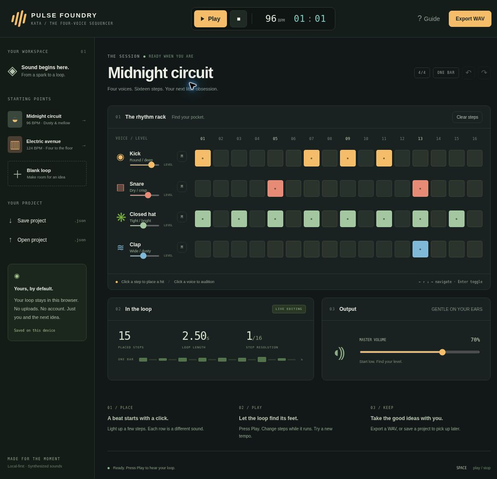
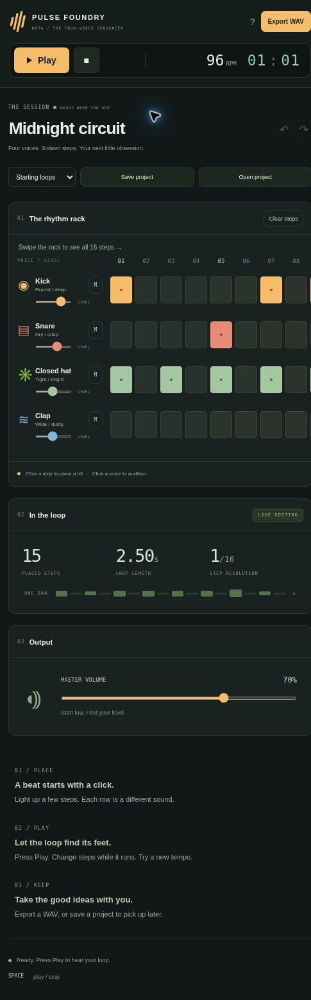

# Kata Pulse Foundry

**Four voices. Sixteen steps. Your next little obsession.**

An original, deliberately small browser drum sequencer inspired by the pattern-first workflow of FL Studio. The first prototype focuses on the agreed essentials: **four channels, one grid, and play/stop**. It is a learning kata, not a full digital audio workstation.



## Start locally

Requires Node.js 18 or newer. There are **no third-party runtime dependencies**, installation steps, accounts, external fonts, or sample downloads.

```sh
npm start
```

Open the HTTP address printed in the terminal, normally **http://127.0.0.1:4173/**. Do not double-click `index.html` or use a `file://` URL: native JavaScript modules need an HTTP server.

```sh
npm run check   # Syntax checks and automated tests
npm run build   # Static distributable in dist/
```

`PORT` and `HOST` can override the local server's defaults. The server binds to loopback by default. `app.json` describes the app for the Kata Tool Shed catalog; it does not claim a public deployment.

## Make a loop

1. Press **Play** to hear the starter loop.
2. Click a step to add or remove a hit. The 16 steps form one bar of 4/4; groups of four show the beats.
3. Change tempo between **60 and 180 BPM**. Edit steps while the loop plays.
4. Click a voice name to audition it. Adjust its level or use **M** to mute it.
5. Try the *Midnight circuit* or *Electric avenue* starting points, or open a blank loop.
6. Use **Export WAV** for audio, or **Save project** for the editable JSON project.

### Keyboard

- Space: play/stop when focus is outside an editable field or button.
- Arrow keys: move between step buttons. Home/End: first/last step in a row.
- Enter or Space on a step: toggle it.
- Ctrl/⌘ Z: undo. Ctrl/⌘ Shift Z: redo, outside text controls.
- Tab: move between normal controls. The step grid uses one tab stop with arrow navigation.
- Escape: dismiss a confirmation or guide dialog.

On narrow screens, swipe horizontally **inside the rack** to reach every step. Voice labels stay visible. The rest of the page fits the viewport.

## What is included

- Kick, snare, closed hat, and clap, synthesized entirely in the browser.
- One 16-step repeating loop with audio-clock lookahead scheduling.
- Play/stop, visible position, tempo, four levels and mutes, master level.
- Live editing, 80-step undo/redo history, and automatic local browser saving.
- JSON export/import with size, version, type, and bounds validation.
- Deterministic, offline-rendered, 44.1 kHz / 16-bit stereo WAV export. The current mix is centered in both channels. Export contains one bar plus a 0.6-second release tail, so it is **not a seamless-loop file**.
- Native buttons with accessible labels, pressed states, focus indicators, and keyboard navigation.

## Scope and limitations

This first prototype intentionally has **no piano roll, song arrangement, mixer routing, effects plugins, recording, imported samples, MIDI, or FLP support**. These are not nonfunctional UI placeholders: they are outside the agreed first version.

Playback starts only after a user gesture and pauses when the tab enters the background. Live step edits may take up to the 120 ms scheduling lookahead to take effect. Tempo changes preserve the next already-scheduled hit and then use the new step duration. Real-time output depends on browser and device performance.

Projects stay in this browser's local storage. Clearing site data, private browsing, storage limits, or switching devices can remove or separate the autosave. Download a project file for a durable backup. Nothing is uploaded by the app.

Browser QA was performed in Chromium on localhost at desktop and 485 CSS-pixel narrow widths. Hardware listening, physical phone testing, Safari, and Firefox have not been completed. See [QA notes](docs/QA.md).

## Project structure

- `src/model.js`: small project schema, validation, presets, timing, events.
- `src/synth.js`: deterministic voices, offline mix, PCM WAV encoder.
- `src/audio.js`: Web Audio playback, scheduling, interruption/stop handling.
- `src/app.js`: accessible interaction, editing history, storage, file workflows.
- `tests/`: model, audio-engine, synthesis, WAV, and server checks.
- `docs/screenshots/`: genuine, unedited browser captures.
- `app.json`: catalog metadata with screenshot dimensions and provenance.

## Workflow research and originality

Image-Line's official [Channel Rack and Step Sequencer documentation](https://www.image-line.com/fl-studio-learning/fl-studio-online-manual/html/channelrack.htm) describes pattern-grid drum programming. Its [workflow overview](https://www.image-line.com/fl-studio-learning/fl-studio-online-manual/html/basics_workflow.htm) and [Playlist documentation](https://www.image-line.com/fl-studio-learning/fl-studio-online-manual/html/playlist.htm) informed the scope discussion. This prototype implements only the small step-sequencer portion.

Pulse Foundry has original branding, layout, code, starter patterns, and synthesized sounds. It includes no FL Studio artwork, samples, proprietary code, or project compatibility. FL Studio is a product of Image-Line; this project is not affiliated with or endorsed by Image-Line.

## License

MIT. The local development server, build script, and OS ignore baseline were adapted from the earlier Kata Sound Lab project; attribution is retained in [LICENSE](LICENSE). The combined `.gitignore` includes macOS, Windows, Linux, editors, generated output, and local secrets.

## Narrow-screen view


